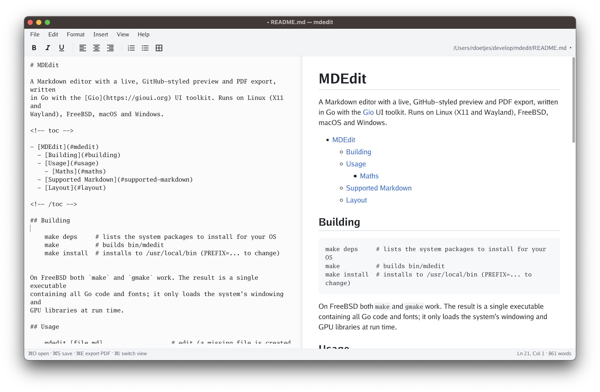

# MDEdit

A Markdown editor with a live, GitHub-styled preview and PDF export, written
in Go with the [Gio](https://gioui.org) UI toolkit. Runs on Linux (X11 and Wayland), FreeBSD, macOS and Windows.



<!-- toc -->

- [MDEdit](#mdedit)
  - [Building](#building)
  - [Usage](#usage)
    - [YouTube videos](#youtube-videos)
    - [Maths](#maths)
    - [Fenced blocks (code blocks)](#fenced-blocks-code-blocks)
  - [In the browser (WebAssembly)](#in-the-browser-webassembly)
  - [Supported Markdown](#supported-markdown)
  - [Layout](#layout)

<!-- /toc -->

## Building

    make deps     # lists the system packages to install for your OS
    make          # builds bin/mdedit
    make install  # binary, menu entry and icons under /usr/local (PREFIX=... to change)

`make install` (run with sudo) also adds MDEdit to the application menu on
Linux and FreeBSD desktops: `share/applications/mdedit.desktop` (categories
Development, Office and Science; it opens Markdown files) and the icon in
all standard sizes under `share/icons/hicolor`. `make desktop` only writes
`bin/mdedit.desktop`; `make icons` redraws the icons from `tools/mkicon`.
For a per-user install without root, `make-desktop.sh` is still there.

On macOS, `make macos` builds `bin/MDEdit.app` with its icon; drag it into
Applications. Markdown files then offer MDEdit under the Finder's "Open
With" (it doesn't make itself the default app), and you can drop a file on
its Dock icon. The app is signed ad hoc, which is all a locally built app
needs; to give it to someone else it would need a Developer ID signature.

On FreeBSD both `make` and `gmake` work. The result is a single executable
containing all Go code and fonts; it only loads the system's windowing and
GPU libraries at run time.

## Usage

    mdedit [file.md]                   # edit (a missing file is created on save)
    mdedit -pdf file.md [-o out.pdf]   # export without opening a window

All commands are in the menu bar (File, Edit, Format, Insert, View, Help);
the toolbar holds the common ones: bold, italic, underline, alignment,
numbered/bullet lists and table. Main shortcuts (⌘ instead of Ctrl on macOS):

| Shortcut               | Action                    | Shortcut          | Action           |
|------------------------|---------------------------|-------------------|------------------|
| Ctrl+N / Ctrl+O        | New / Open                | Ctrl+B / I / U    | Bold / Italic / Underline |
| Ctrl+S / Ctrl+Shift+S  | Save / Save as            | Ctrl+Shift+L/E/R  | Align left / center / right |
| Ctrl+E                 | Export PDF                | Ctrl+1 … 6, Ctrl+0 | Heading 1–6 / paragraph |
| Ctrl+/                 | Cycle split/editor/preview | Ctrl+T           | Insert table     |
| Ctrl+Q                 | Quit                      | Ctrl+K / Ctrl+Shift+K | Link / code block |
| Ctrl+F / Ctrl+R        | Find / Replace            | Ctrl+G / Ctrl+Shift+G | Next / previous match |
| Ctrl+Shift+D           | Dark / light theme        |                   |                  |

View → Dark Theme (Ctrl+Shift+D) switches the whole window — menus,
dialogues, editor and preview, including code highlighting — to a dark theme
modelled on GitHub's; the menu item then reads Light Theme. The choice is
saved in `settings.json` in the user's config directory
(`~/.config/mdedit/` on Linux and FreeBSD, `~/Library/Application
Support/mdedit/` on macOS). Until a choice is saved, mdedit follows the
system's dark mode where it can detect it (macOS, Windows) and starts light
elsewhere. Exported PDFs are always light, since they are meant for paper.

Find (Ctrl+F) and Replace (Ctrl+R) open a bar above the editor; the
selected text becomes the search text. All matches are highlighted, the
counter shows "3 of 12", Enter and Shift+Enter go to the next and previous
match (wrapping around), and Escape closes the bar. Matching ignores case
unless Match case is ticked. Replace replaces the selected match and moves
to the next; Replace All replaces every match in one undoable step.

Pressing Enter in a list item or quote starts the next item (numbers count
up); Enter on an empty item ends the list. Shift+Enter inserts a plain line
break.

Tab inserts spaces to the next 4-column stop; on list items (or several
selected lines) Tab and Shift+Tab indent and outdent, nesting list items.
Tab characters in opened or pasted text are converted to spaces, which is
how CommonMark reads them anyway (Gio's text engine can't display tabs).

Insert → Table of Contents adds a nested list of links to all headings,
between `<!-- toc -->` and `<!-- /toc -->` markers (hidden when rendered,
and the convention markdown-toc and VS Code use). Right-click in the editor
or preview and choose Update Table of Contents to regenerate it after
editing headings; the right-click menu also has Cut, Copy and Paste.

The spelling of the text is checked as you type: misspelt words get a red
wavy underline once the caret has left them. Right-click one to see the
most likely corrections at the top of the menu; click one to replace the
word. Add to Dictionary remembers the word for good (in `settings.json`),
Ignore until mdedit quits. Code, maths, HTML, link targets, URLs, file
names, words with digits, acronyms in capitals and camelCase words aren't
checked. Edit → Hide Spelling Errors turns the checking off.

English (American and British spellings, from
[SCOWL](http://wordlist.aspell.net)) is built in. Edit → Spelling
Languages… adds about 60 more, such as Dutch, German, French and Spanish:
tick them and click OK, and the ones not on your computer yet are
downloaded in the background (the LibreOffice/Hunspell dictionaries, via
[wooorm/dictionaries](https://github.com/wooorm/dictionaries); each has its
own licence). They are kept in `dictionaries/` next to `settings.json`. You
can tick several: a word is correct if any of them knows it, which suits
Dutch or German text full of English terms. Compound words (Dutch
"spellingcontrole", German "Rechtschreibprüfung") and elisions (French
"l'homme") are understood. In the browser the dictionaries are downloaded
again on each visit.

View → Show Outline (Ctrl+Shift+O) opens a sidebar listing the document's
headings, indented by level. Click one to show it at the top of the editor
and the preview; the heading of the section you are typing in is
highlighted. The sidebar stays open (or closed) the next time.

### YouTube videos

Videos use GitHub's notation, a link around the video's still:

    [](https://www.youtube.com/watch?v=VIDEO_ID)

Insert → YouTube Video… (or the toolbar button) asks for the video ID — a
full YouTube link works too — and an optional title. The preview shows the
still at 66% of the width with a play button; clicking it opens the video in
the browser. PDFs show just the still, linked to the video.

Stills are downloaded in the background and cached in `~/.cache/mdedit/images`
(`~/Library/Caches/mdedit/images` on macOS). Only YouTube stills are fetched,
never other remote images; when a video has no full-resolution still,
YouTube's standard one is used.

Example me covering the Trooper: 
<div align="center">

[](https://www.youtube.com/watch?v=XIiJa9yDecU)

</div>

### Maths

Display maths goes between `$$` lines (or ` ```math ` fences, as on GitHub);
inline maths between single dollars: `$e^{i\pi} + 1 = 0$`. As in Pandoc and
Typora, `$` followed by a space, or a closing `$` before a digit, isn't
maths, so `$5 and $10` stays text; write `\$` for a literal dollar sign.

mdedit typesets maths itself (no JavaScript, no network) with the STIX Two
Math font (SIL Open Font License, embedded): fractions, roots, sub- and
superscripts, large operators with limits, stretchy `\left … \right`
delimiters, accents, Greek and symbols, `\text`, `\mathbb` / `\mathcal` /
`\mathbf` …, and the `matrix` / `pmatrix` / `bmatrix` / `vmatrix`, `cases`,
`aligned` and `array` environments. Lines separated by `\\` (with `&`
alignment points) work without an environment too. Unknown commands are
shown in red. In PDFs, maths is drawn as vector outlines, so it isn't
selectable as text.

Insert → Math Block (Ctrl+Shift+M) and Format → Inline Math add the markup.

Example 1:
$$
E=mc^2
$$
Example 2:
$$
\sqrt{a}=b \qquad \text{iff} \quad b^2=a \
$$
Example 3:
$$
\sqrt{e}\, \sqrt{T}\,\sqrt{T^2_1}
$$

### Fenced blocks (code blocks)

Fenced code blocks are highlighted by the language after the fence
(` ```go `, ` ```bash `, ` ```C# `, ` ```c++ `, ` ```yaml `, ` ```{.python} `
…), covering about 250 languages and their usual aliases.

On macOS the usual ⌘ navigation works in the editor: ⌘←/⌘→ to the start/end
of the line, ⌘↑/⌘↓ to the start/end of the document (add ⇧ to select), and
⌘⌫ to delete to the start of the line. Home/End (fn+←/→) work everywhere.

Markdown has no underline or alignment syntax, so mdedit uses the HTML that
GitHub and Typora render: `<u>text</u>`, and a `<div align="center">` wrapper
with blank lines inside so the content is still parsed as Markdown.

The divider between editor and preview can be dragged. The preview follows
the caret. Clicking a `#anchor` link jumps to the heading, relative `.md`
links open in the editor, and other links open in the system browser.

If the window is closed with unsaved changes, they are written to
`~/.cache/mdedit/` (`~/Library/Caches/mdedit/` on macOS) and the path is
printed on stderr.

## In the browser (WebAssembly)

The same editor also runs in a web browser. The desktop version remains the
main one; the browser version is the same program compiled to WebAssembly,
with a different way of reaching files.

    make wasm     # bin/web (the web page) and bin/mdedit-web (a small web server)
    make serve    # try it on http://localhost:8089

`bin/web` holds `index.html`, `mdedit.wasm` (with compressed `.gz` and, if
the `brotli` command exists, `.br` copies), Go's `wasm_exec.js` and the icon.
Any web server can serve it if it sends `.wasm` files as `application/wasm`;
`mdedit-web` does that and sends the compressed copies (about 6–8 MB instead
of 30 MB).

**In a FreeBSD jail.** On the FreeBSD host, build as yourself, then install
as root:

    make wasm
    sudo make install-jail

This copies the web files to
`/zroot/sylve/jails/100/usr/local/www/content_renderer/`, the server to the
jail's `/usr/local/bin/mdedit-web`, and the service script to the jail's
`/usr/local/etc/rc.d/mdedit_web`; it enables the service in the jail's
`rc.conf` and, if the jail is running, (re)starts it. Override the
locations with `JAIL_ROOT=…` and `WEBROOT=…`. The service listens on port
8089 as user `www`; change it with:

    sudo sysrc -R /zroot/sylve/jails/100 mdedit_web_addr=":8089"
    sudo sysrc -R /zroot/sylve/jails/100 mdedit_web_flags="-tls-cert /usr/local/etc/ssl/mdedit.crt -tls-key /usr/local/etc/ssl/mdedit.key"

and `service mdedit_web restart` inside the jail. Logs go to the jail's
`/var/log/mdedit_web.log`.

**Use HTTPS.** Browsers only allow web pages to use the clipboard over
HTTPS (or on `localhost`). Over plain HTTP from another machine, copy and
paste within mdedit won't work. Give `mdedit-web` a certificate
(`-tls-cert`, `-tls-key`), or put it behind a web server or proxy that
does HTTPS. For Caddy, `assets/caddy/Caddyfile` is a ready site block
(`markdown.phonax.com` → the jail's port 8089); fill in the jail's address.

**What is different in the browser:**

- **Files.** A web page can't read or write your disk. File → Open shows
  the browser's file picker; Save, Save As and Export PDF download the
  file. The text is kept in the browser (localStorage) as you type, so a
  reload or a closed tab loses nothing, and the next visit continues where
  you were.
- **Images.** Images next to a document can't be read, so they show their
  alt text; YouTube stills work as on the desktop.
- **Shortcuts.** On a Mac they use ⌘, elsewhere Ctrl. Browsers keep a few
  keys for themselves (Ctrl/⌘+N, T and W): use the menus for New and Insert
  Table. There is no Quit; close the tab.
- **Theme.** The first visit follows the browser's light or dark mode;
  View → Dark Theme is remembered in the browser.
- **Size.** The first visit downloads about 6–8 MB; after that the
  browser's cache is used until a new version is installed.

## Supported Markdown

CommonMark plus GitHub extensions: headings (ATX and Setext), paragraphs and
hard line breaks, emphasis, strong, ~~strikethrough~~, inline code, fenced and
indented code blocks with syntax highlighting (via
[chroma](https://github.com/alecthomas/chroma), ~250 languages), block quotes
(nested, with any content), ordered/unordered/nested lists, task lists,
tables with column alignment, horizontal rules, links, autolinks, local
images (PNG, JPEG, GIF) and backslash escapes/entities.

## Layout

    cmd/mdedit         entry point (desktop and browser)
    cmd/mdedit-web     web server for the browser version
    internal/mdmodel   Markdown → flat list of styled blocks (goldmark), highlighting
    internal/render    device-independent layout: blocks → positioned primitives
    internal/ui        Gio window, preview painter, file dialog
    internal/pdfout    PDF painter with page breaking (fpdf)
    internal/edit      formatting commands as pure functions on text + selection
    internal/tex       TeX maths typesetter (embedded STIX Two Math)
    internal/youtube   YouTube URLs and video IDs
    internal/imgcache  downloads and caches YouTube stills
    internal/vfs       file storage for images: the disk, or memory in the browser
    internal/lint      code-style test: no anonymous functions, ≤4 indent levels, ≤40-line functions
    tools/mkicon       draws the application icon
    tools/glyphdump    prints how a character is stored in the font (see HOW_IT_WORKS.md §6)
    web/index.html     the web page around the browser version
    assets/freebsd     rc.d script for mdedit-web
    assets/caddy       Caddy reverse-proxy site block for the browser version

The preview and the PDF share `internal/render`, so both use the same layout.

See [HOW_IT_WORKS.md](HOW_IT_WORKS.md) for how the layers fit together, how
input flows through the code, where to add features and where to look for
bugs.
